#  Employee Management System  
## Production-Grade AWS Full-Stack DevOps Platform

---

#  Overview

This is a cloud-native **Employee Management System** that I designed, built and deployed on AWS using modern DevOps practices..
It demonstrates a complete production-style architecture, including:
- Infrastructure as Code (Terraform)
- Containerized backend (Docker + ECS Fargate)
- Secure CI/CD pipeline (GitHub Actions + OIDC)
- Scalable AWS networking (VPC, ALB, RDS)
- Centralized secrets management (AWS Secrets Manager)
- Monitoring & alerting (CloudWatch + SNS)

---

#  Architecture Overview
```text
Frontend (React on S3)
↓
Application Load Balancer (ALB)
↓
ECS Fargate (Node.js API)
↓
Amazon RDS (MySQL)
```

#  CI/CD Pipeline (OIDC Secure Deployment)
```text
GitHub Push
↓
GitHub Actions
↓
OIDC Authentication (No AWS Keys)
↓
Docker Build
↓
Push to ECR
↓
Terraform / ECS Deployment
```

- No static AWS credentials  
- Temporary IAM role assumption  
- Production-grade secure pipeline  

---

#  Tech Stack

## Backend
- Node.js
- Express.js
- Sequelize ORM
- MySQL (AWS RDS)
- JWT Authentication

## Frontend
- React.js
- Axios
- Hosted on AWS S3

## DevOps / Cloud
- AWS ECS (Fargate)
- AWS ALB
- AWS VPC
- AWS RDS (MySQL)
- AWS ECR
- AWS S3
- AWS Secrets Manager
- AWS CloudWatch + SNS
- Terraform (IaC)
- GitHub Actions (CI/CD)
- Docker

---

#  Infrastructure (Terraform Modules)
```bash
infra/
├── modules/
│   ├── vpc
│   ├── ecs
│   ├── alb
│   ├── rds
│   ├── ecr
│   ├── s3-frontend
│   ├── monitoring
│   └── secrets-manager

├── main.tf
├── variables.tf
├── outputs.tf
└── backend.tf
```

- Modular design  
- Reusable components  
- Clean separation of concerns  

---

#  Security Design

- JWT Authentication
- Role-Based Access Control (Admin / HR / Manager / Employee)
- IAM least privilege policies
- GitHub OIDC authentication (no static keys)
- Secrets stored in AWS Secrets Manager
- Private subnets for ECS & RDS
- Security groups for service isolation

---

#  Monitoring & Observability

- CloudWatch logs (ECS containers)

### Alerts
- ECS CPU utilization
- RDS CPU utilization
- ALB 5XX errors
- SNS email notifications

---

#  Core Features

-  Employee Management (CRUD)
-  Department Management
-  Attendance Tracking
-  Leave Workflow System
-  Payroll System
-  Performance Reviews
-  Reporting System
-  File Upload (S3)
-  Authentication System

---
##  CI/CD Pipeline
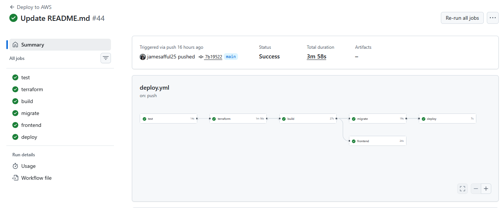

#  UI Screenshots
| Login | Dashboard |
|------|-----------|
| 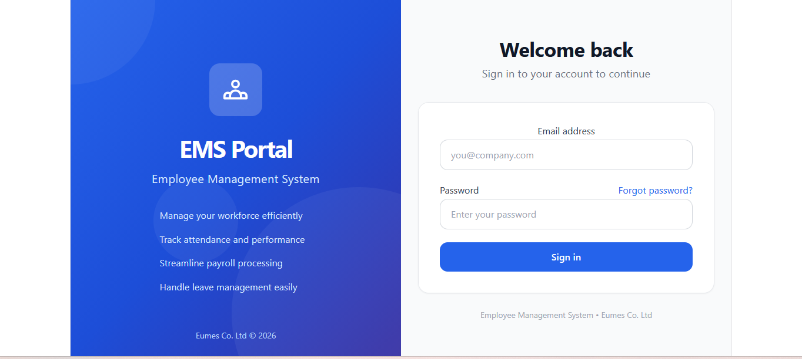 | 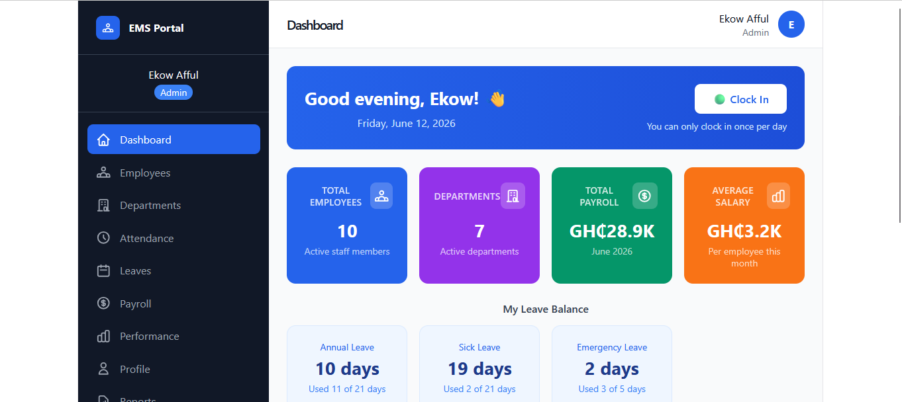 |

| Employees | Departments |
|----------|-------------|
| 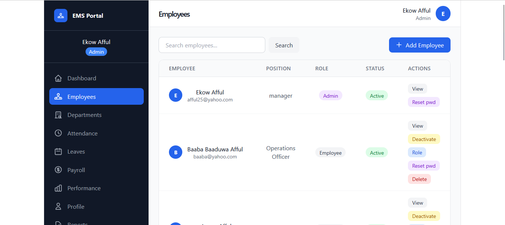 | 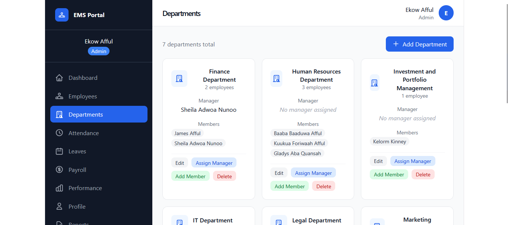 |

| Attendance | Leave |
|-----------|-------|
| 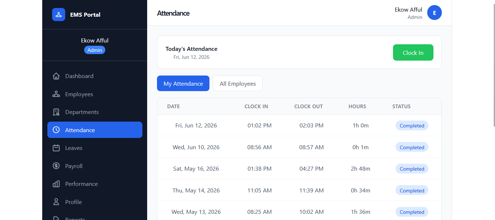 | 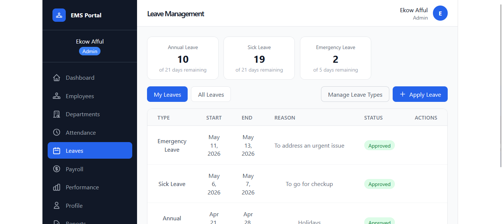 |

| Payroll | Performance |
|--------|-------------|
| 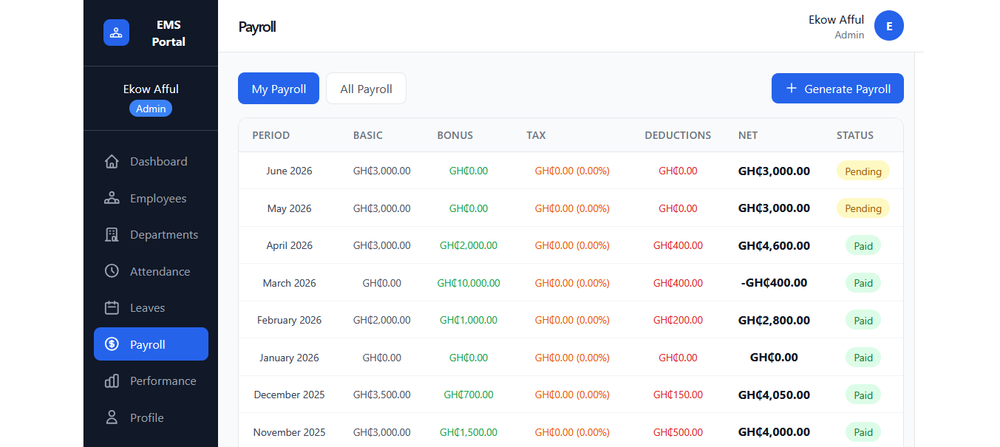 | 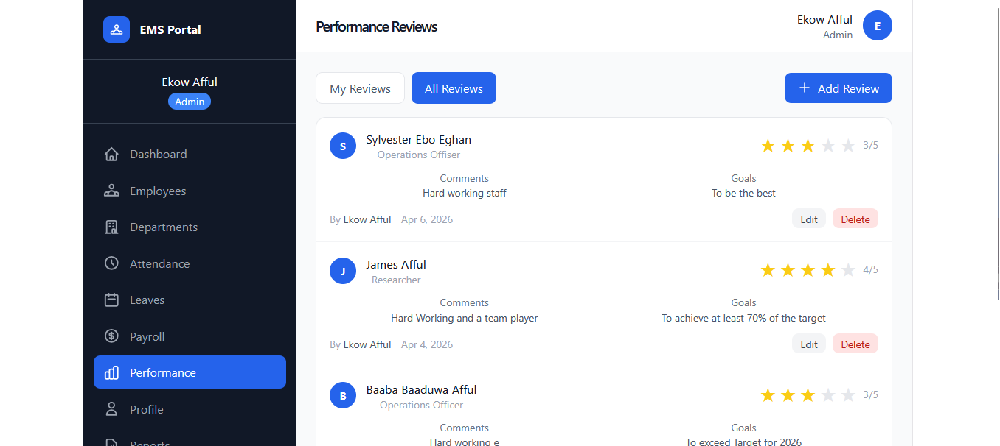 |

| Profile | Report |
|--------|-------------|
| 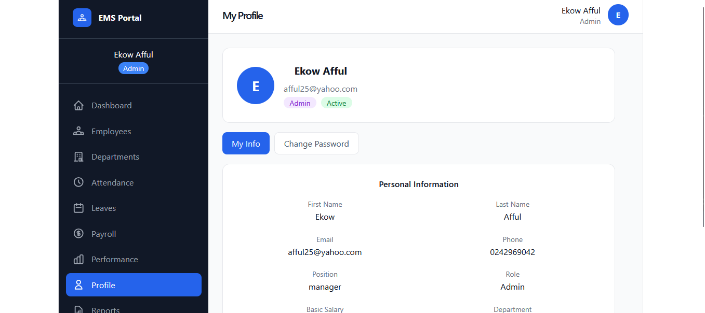 | 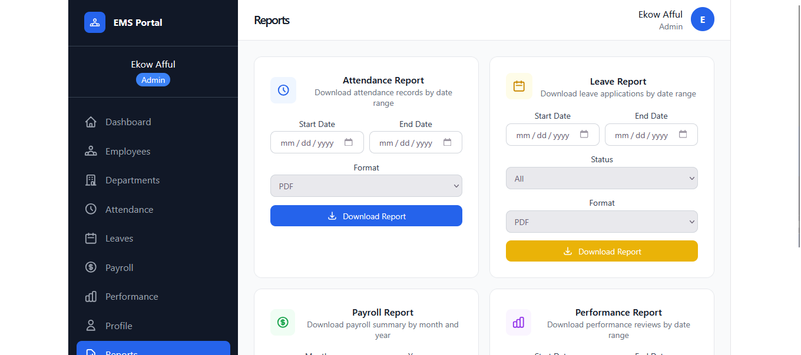 |

|Upload |Report-2 |
|--------|-------------|
| 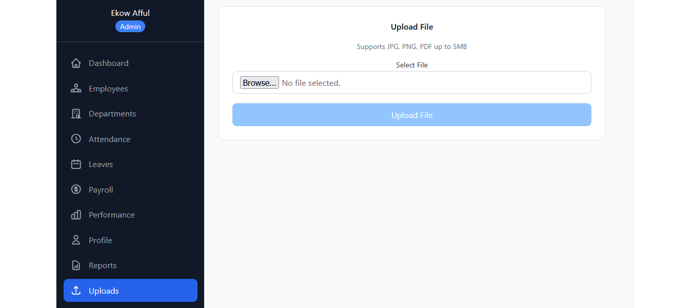 | 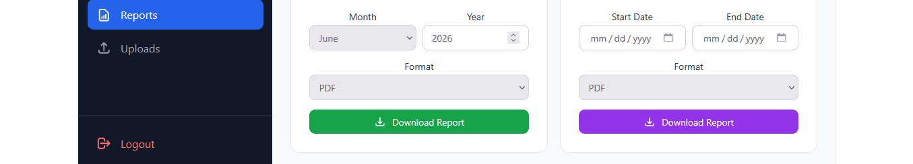 |

##  AWS Infrastructure (Proof of Deployment)

### VPC
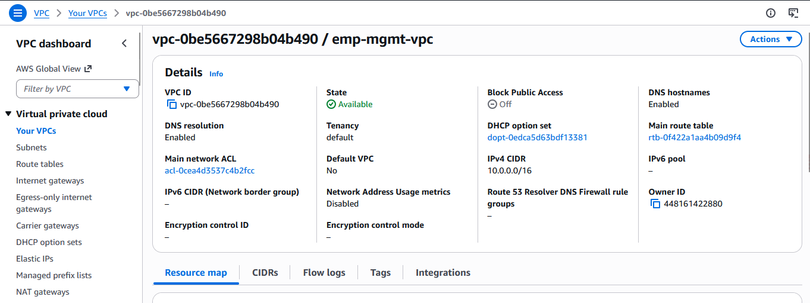

### ECS Cluster
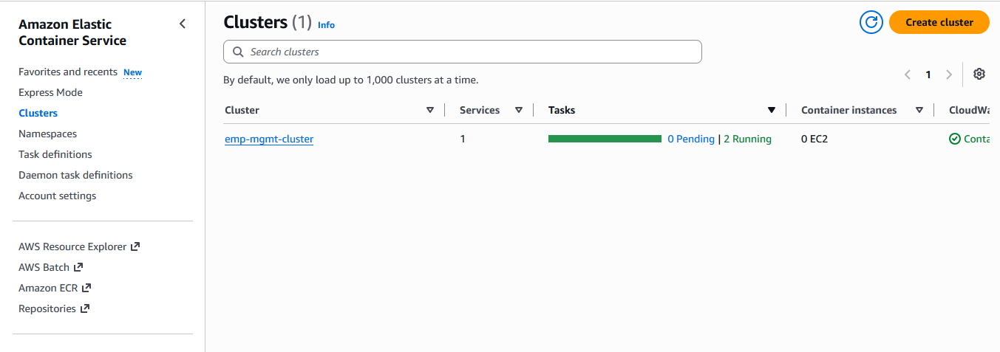

### ECS Service
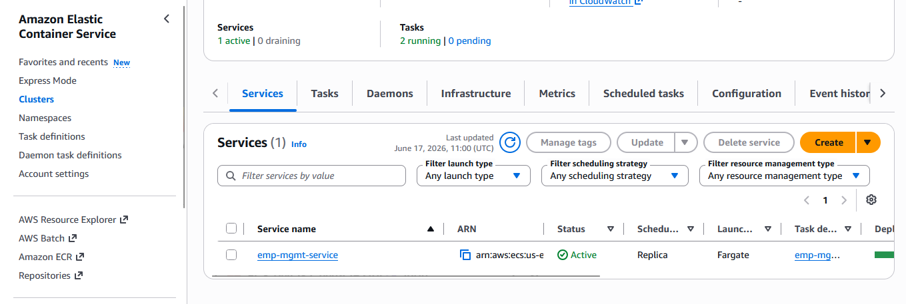

### Task Definition
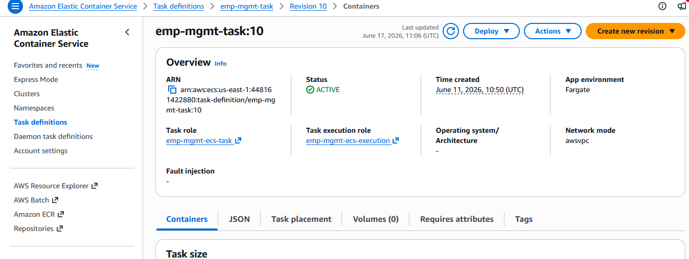

### Load Balancer
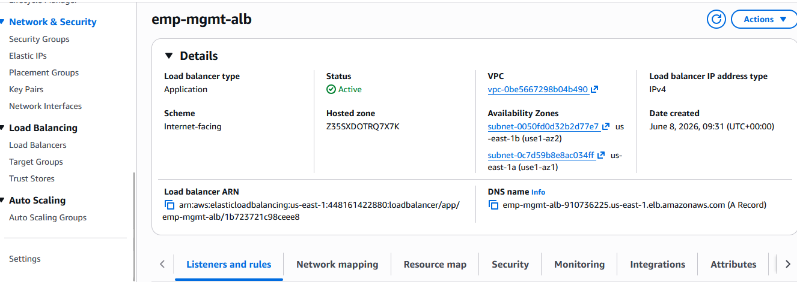

### Target Group
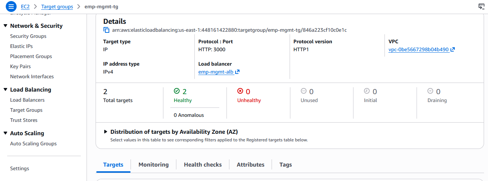

### RDS Database
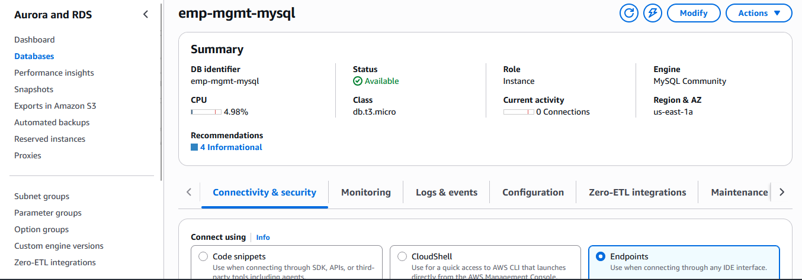

### ECR Repository
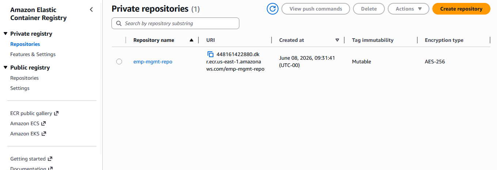

### CloudWatch Monitoring
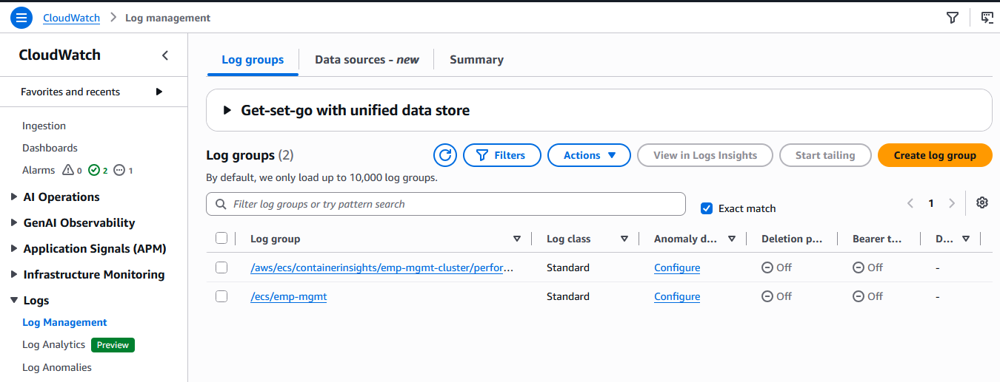

### IAM OIDC Role
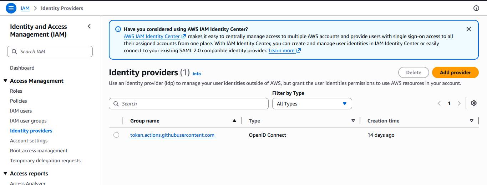

### Secrets Manager
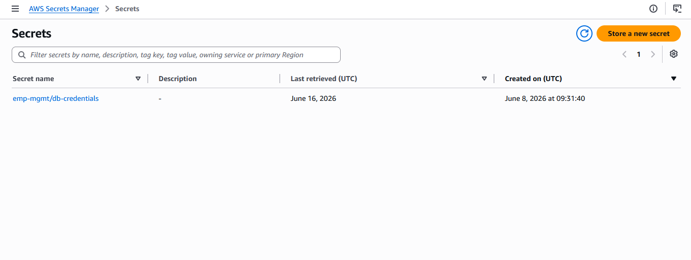

---

#  Deployment Workflow
```text
Push to GitHub
↓
GitHub Actions Triggered
↓
Docker Image Built
↓
Pushed to AWS ECR
↓
ECS Service Updated
↓
Zero-Downtime Deployment
```

# 👤 Author

**James Afful**  
**Full-Stack Developer | DevOps & Cloud Engineer | AI Automation Engineer | Data Scientist & Analytics | Economist & Financial Analyst**

I am a multidisciplinary technology and finance professional with experience building full-stack web applications, designing cloud infrastructure, automating business processes, developing data-driven solutions and applying economic and financial analytics to real-world problems.

I designed and developed the Expense Tracker application, including its React frontend, Node.js/Express backend, database architecture, authentication system, reporting functionality and AWS deployment infrastructure.

### Core Technical Expertise

- **Frontend Development:** React.js, Vite, JavaScript, Tailwind CSS, HTML5, CSS3, Recharts
- **Backend Development:** Node.js, Express.js, Python, REST APIs, Sequelize
- **Cloud Engineering:** AWS, Azure, Amazon ECS, ECR, RDS, S3, CloudFront, IAM
- **DevOps & Infrastructure:** Terraform, Docker, Kubernetes, GitHub Actions, CI/CD, Infrastructure as Code
- **AI Automation Engineering:** Python-based AI automation, OpenAI API integration, workflow automation, n8n
- **Data Science & Analytics:** Python, SQL, Power BI, Predictive Analytics, Statistical Modelling, Data Visualization
- **Database Technologies:** MySQL, SQL
- **Economics & Finance:** Economic Research, Financial Modelling, Investment Analysis, Credit Risk Modelling, Corporate Finance

### Professional Links

- **GitHub:** https://github.com/jamesafful25
- **Portfolio:** https://jamesafful25.github.io/james-afful-portfolio/
- **Email:** james.afful47@gmail.com

---

*Designed, developed, and deployed by James Afful.*

---

#  Status

- Project fully decommissioned (cost control)  
- Architecture fully documented  
- CI/CD pipeline implemented (OIDC secure)  
- Screenshots preserved as proof of deployment  
- Portfolio-ready DevOps project  
